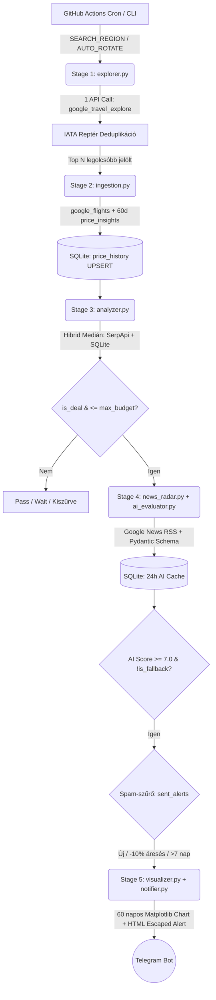

# ✈️ Flight Deal Radar – Automated ETL & AI Travel Decision Pipeline

Kétfázisú, adatvezérelt repülőjegy-kutató és döntéstámogató ETL pipeline, amely régiós szinten pásztázza a legolcsóbb utazási ablakokat, hibrid historikus medián alapján szűri az áreséseket, élő Google News RSS hírekkel és strukturált LLM (Gemini) hívással értékeli a célállomásokat, majd 60 napos ártrend-grafikonnal kiegészítve riasztást küld Telegramon.

---

## 🎯 Főbb Mérnöki Megoldások (Key Engineering Highlights)

1. **Kétlépcsős API Kvóta-Optimalizáció (`AUTO_ROTATE`):**
   - Ahelyett, hogy városonként külön API-hívásokat indítana, az 1. fázis (`explorer.py`) egyetlen `google_travel_explore` kéréssel (Google Knowledge Graph ID alapján) lehúzza egy teljes ország legolcsóbb közvetlen dátumpárjait, majd IATA-kód szerint deduplikálja a reptereket.
   - A 2. fázis (`ingestion.py`) kizárólag a legolcsóbb `Top N` (alapértelmezetten 2) jelöltre futtatja le a mélyelemzést (`google_flights`).
   - **Erőforrás-menedzsment:** Napi `1 Explore + 2 Flights = 3 API kredit` (~90 kredit/hó), így a rendszer a napi ütemezett futás mellett is belül marad a SerpApi 100-as ingyenes havi keretén, miközben az `AUTO_ROTATE` algoritmus 3 napos ciklusban forgatja a célrégiókat (`ITALY`, `GREECE`, `SPAIN`).

2. **Cold-Start Hibrid Árelemző (`analyzer.py`):**
   - Összefésüli a Google Flights 60 napos historikus árait (`price_insights`) a saját SQLite adatbázisban (`price_history`) gyűjtött mérésekkel. Így a rendszer már az első futás napján releváns historikus mediánt és áresési százalékot (`discount_pct`) számol.

3. **Strukturált AI Értékelő + Élő Hírradar (`news_radar.py` & `ai_evaluator.py`):**
   - Az utazási célpont és a légitársaság elmúlt 14 napi híreit (sztrájkok, időjárási anomáliák) ingyenes Google News RSS feedből nyeri ki.
   - A Gemini API válaszát **Pydantic sémával** (`DestinationReview`) validálja, 24 órás SQLite cache-eléssel (`TTL < 1.0 nap`).
   - **Determinisztikus költségindex:** A helyi megélhetési költségeket nem az LLM becsüli meg, hanem egy Numbeo-alapú determinisztikus költségtábla (`CITY_DAILY_COSTS_EUR`) szolgáltatja.

4. **Idempotens Adattárolás és CI/CD Állapotmegőrzés (`database.py` & `radar.yml`):**
   - Tranzakció-biztos (`@contextmanager`) SQLite kapcsolatkezelés `UPSERT` (`ON CONFLICT DO UPDATE`) logikával.
   - A GitHub Actions workflow (`actions/cache@v4`) futások között megőrzi és továbbörökíti a `flights.db` SQLite adatbázist anélkül, hogy bináris fájlokkal terhelné a Git commit történetet.

---

## 🏗 Rendszerarchitektúra



---

## 🚀 Telepítés és Futtatás Lokálisan

### 1. Klónozás és virtuális környezet
```bash
git clone https://github.com/<felhasznaloneved>/flight-deal-radar.git
cd flight-deal-radar
python -m venv venv

# Windows:
venv\Scripts\activate
# Linux / macOS:
source venv/bin/activate

pip install -r requirements.txt
```

### 2. Környezeti változók (`.env`) beállítása
Hozz létre egy `.env` fájlt a projekt gyökerében az alábbi sablon alapján:
```env
SERPAPI_KEY=your_serpapi_key
GEMINI_API_KEY=your_gemini_api_key
TELEGRAM_TOKEN=your_telegram_bot_token
TELEGRAM_CHAT_ID=your_telegram_chat_id

# Opcionális keresési paraméterek
SEARCH_ORIGIN=BUD
SEARCH_REGION=AUTO_ROTATE
SEARCH_MONTH=0
SEARCH_DURATION=2
MAX_BUDGET_HUF=55000
TOP_N_VERIFY=2
```

### 3. Unit tesztek és a Pipeline indítása
```bash
# Izolált unit tesztek futtatása
python -m unittest discover -s tests -v

# ETL Pipeline indítása
python main.py
```

---

## ⚙️ Automatizálás (GitHub Actions)

A `.github/workflows/radar.yml` munkafolyamat minden nap **08:00 CET (07:00 UTC)** időpontban automatikusan lefut, vagy az **Actions -> Run workflow** felületen legördülő menüből kézzel is elindítható bármely régióra (`AUTO_ROTATE`, `ITALY`, `GREECE`, `SPAIN`, `EUROPE`).